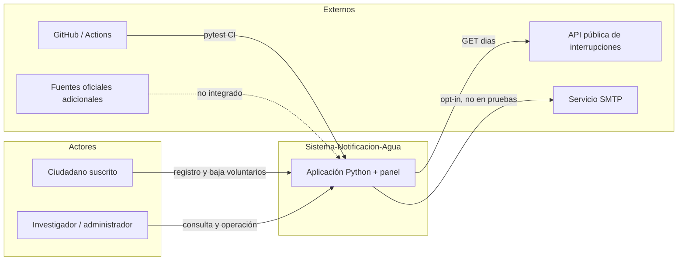
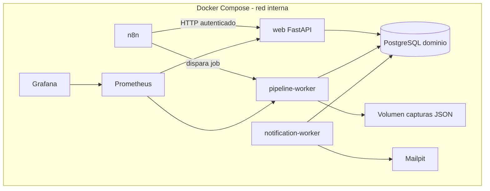
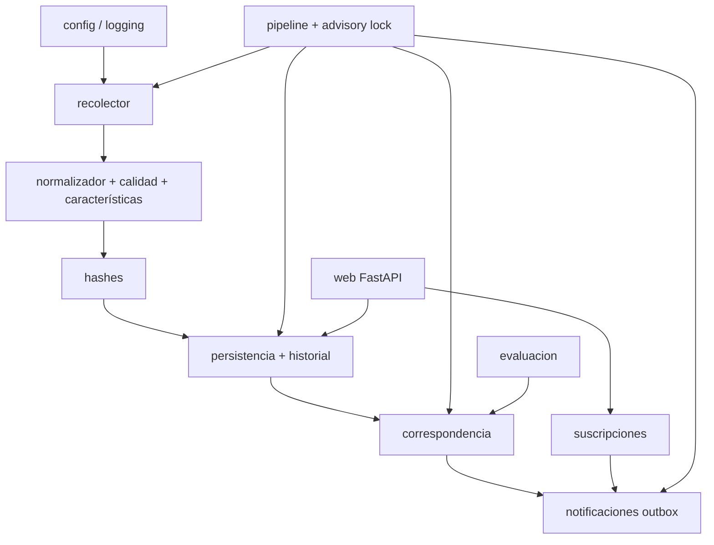
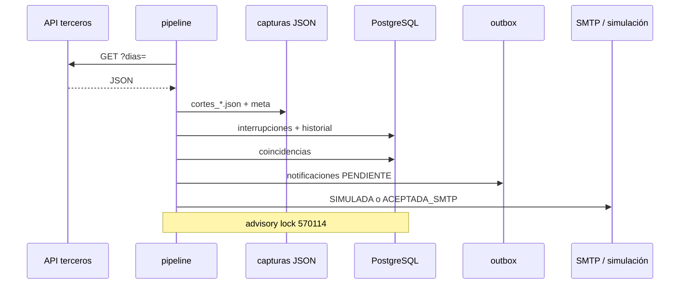
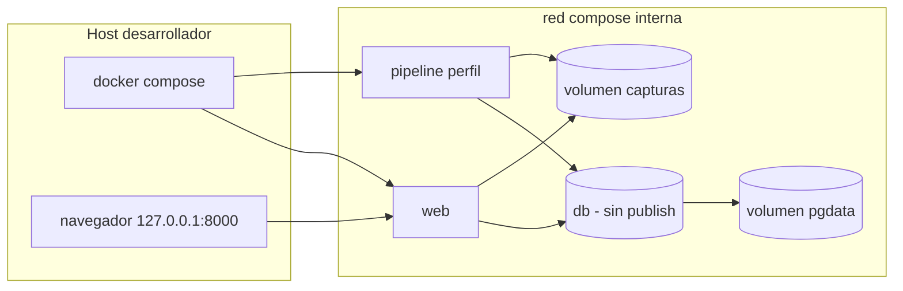
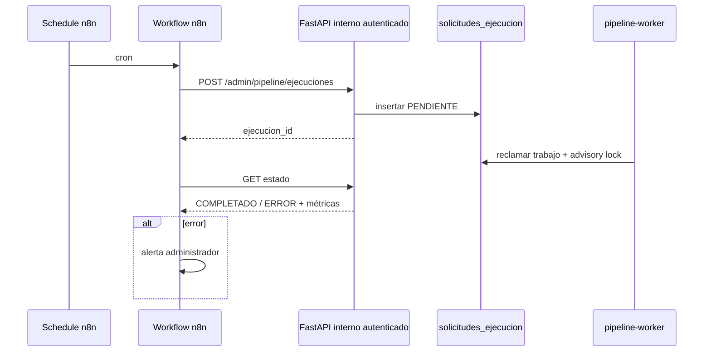
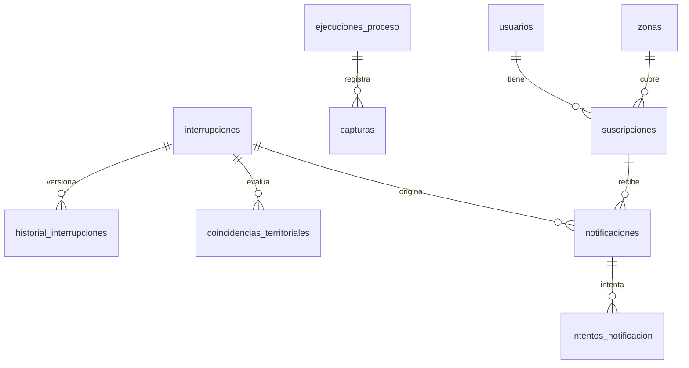

# Arquitectura objetivo — Sistema-Notificacion-Agua

Documento de diseño alineado con el diagrama adjunto a la tesis (fuentes externas, Compose, n8n, Python, datos, observabilidad, calidad). Distingue **as-is** (código actual) de **to-be** (evolución por fases).

**Fecha:** 8 de noviembre de 2026 (America/Lima).  
**Fuente de incidencias:** API pública de un tercero (`https://cortedeagua.net.pe/api.php`). No es API oficial de SEDAPAL.  
**Fuentes oficiales complementarias:** posibilidad futura; línea punteada en el diagrama; **no se integran**.

Leyenda de estado: **Implementado** · **Implementado sin verificar** · **Parcial** · **Pendiente**.

---

## 1. Contexto del sistema

| Elemento | Estado |
|----------|--------|
| API de terceros + cliente HTTP | Implementado |
| Ciudadano (suscripción, confirmación, baja) | Implementado |
| Investigador (panel) | Implementado |
| SMTP real | Parcial (código listo, desactivado) |
| GitHub Actions | Pendiente (fase 5) |
| Fuentes oficiales adicionales | Pendiente (fuera de alcance MVP) |

---

## 2. Contenedores y servicios (Compose)

| Servicio Compose | Fase | Estado al cerrar fase 1 |
|------------------|------|-------------------------|
| `db` PostgreSQL + volumen + healthcheck, **sin puerto publicado en el host** | 1 | Implementado (archivos; verificación Docker según entorno) |
| `web` FastAPI | 1 | Implementado (archivos) |
| `pipeline` (mismo imagen, comando distinto) | 1 | Implementado (archivos; perfil `pipeline`) |
| `notification-worker` | 3 | Pendiente |
| `n8n` + BD/credenciales separadas | 2 | Pendiente |
| `mailpit` | 2–3 | Pendiente |
| `prometheus` / `grafana` | 4 | Pendiente |

Una sola imagen Python para `web` y `pipeline`. n8n no ejecuta SQL del dominio.

---

## 3. Componentes Python

Todos los módulos de la tabla anterior **existen** en `src/`. El worker de notificaciones como **proceso independiente** está **pendiente** (fase 3); hoy el outbox se consume al final del pipeline.

---

## 4. Flujo de ingesta y notificación

| Paso | Estado |
|------|--------|
| Ingesta, JSON, hashes, historial, correspondencia, outbox | Implementado |
| Consumo outbox en proceso separado | Pendiente (fase 3) |
| Disparo por n8n sin bloquear HTTP | Pendiente (fase 2; tabla de trabajos) |

---

## 5. Despliegue Docker (fase 1)

El Postgres de Windows del tesista **no** se monta ni se publica el de Docker en `0.0.0.0`. El mapeo de `web` queda en `127.0.0.1:8000`.

---

## 6. Integración n8n (fase 2 — no implementada)

n8n no duplica correspondencia ni escribe el outbox.

---

## 7. Modelo de datos

Historial y outbox son **lógicos** en el mismo PostgreSQL. Id de incidencia de fuente = PK actual (limitación documentada; no se cambia en fase 1 para no migrar datos de Windows).

---

## Observabilidad y calidad (objetivo)

| Pieza | Estado |
|-------|--------|
| Logs de texto INFO | Implementado (fase 1 añade formato JSON opcional) |
| Prometheus / Grafana | Pendiente fase 4 |
| Pytest | Implementado |
| GitHub Actions | Pendiente fase 5 |
| Mailpit | Pendiente fase 2–3 |
