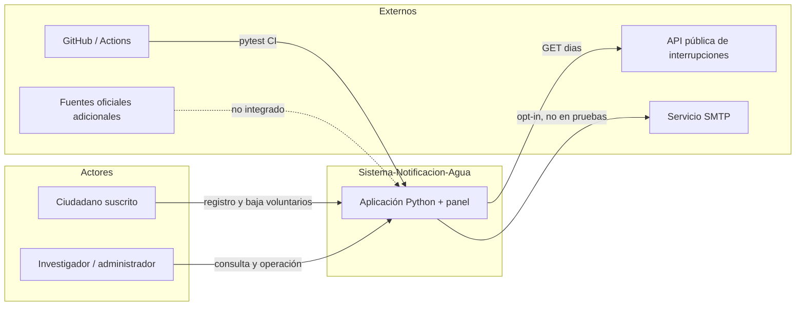
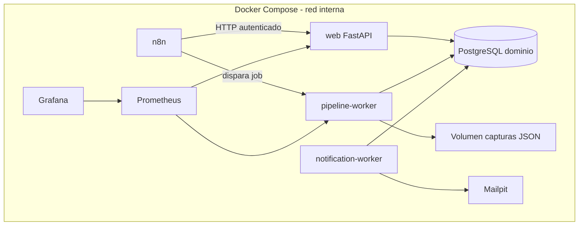
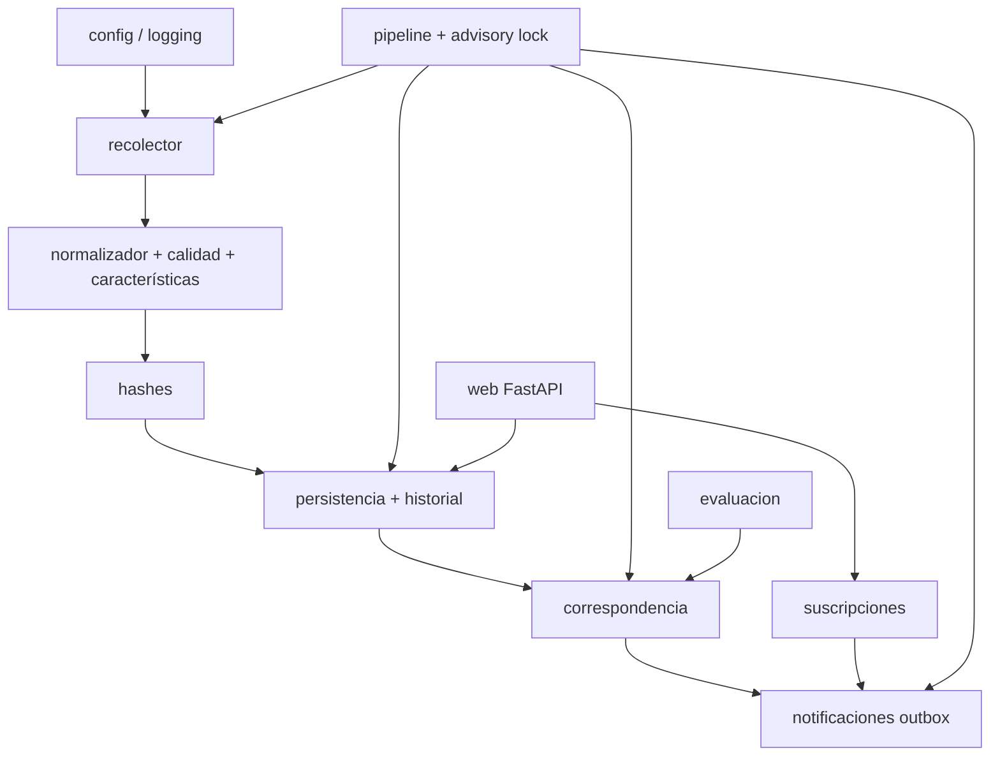
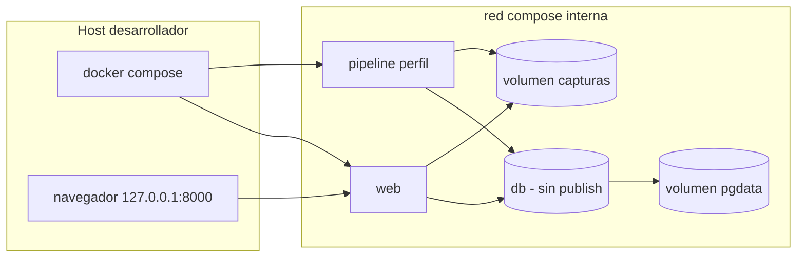
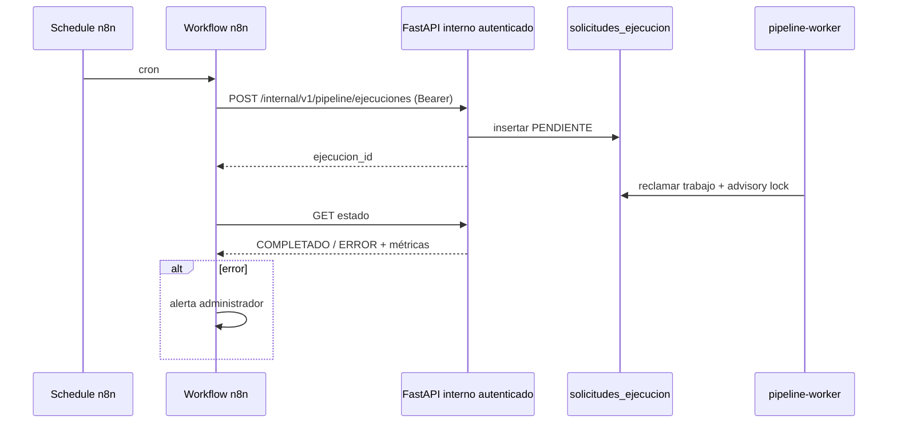
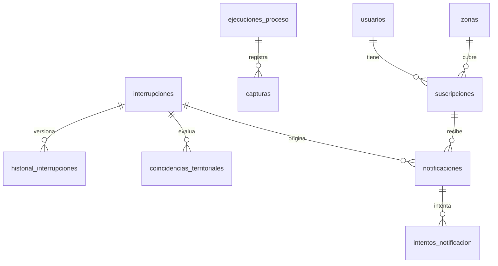

# Arquitectura objetivo — Sistema-Notificacion-Agua

Documento de diseño alineado con el diagrama adjunto a la tesis (fuentes externas, Compose, n8n, Python, datos, observabilidad, calidad). Distingue **as-is** (código actual) de **to-be** (evolución por fases).

**Fecha:** 8 de noviembre de 2026 (America/Lima).  
**Fuente de incidencias:** API pública de un tercero (`https://cortedeagua.net.pe/api.php`). No es API oficial de SEDAPAL.  
**Fuentes oficiales complementarias:** posibilidad futura; línea punteada en el diagrama; **no se integran**.

Leyenda de estado: **Implementado** · **Implementado sin verificar** · **Parcial** · **Pendiente**.

---

## 1. Contexto del sistema



| Elemento | Estado |
|----------|--------|
| API de terceros + cliente HTTP | Implementado |
| Ciudadano (suscripción, confirmación, baja) | Implementado |
| Investigador (panel) | Implementado |
| SMTP real | Parcial (código listo, desactivado) |
| GitHub Actions | Pendiente (fase 5) |
| Fuentes oficiales adicionales | Pendiente (fuera de alcance MVP) |

---

## 2. Contenedores y servicios (Compose)



| Servicio Compose | Fase | Estado |
|------------------|------|--------|
| `db` PostgreSQL + volumen + healthcheck, **sin puerto publicado en el host** | 1 | Implementado y verificado (Windows 11 + Docker Desktop) |
| `web` FastAPI | 1 | Implementado y verificado |
| `pipeline` (CLI, perfil) | 1 | Implementado |
| `pipeline-worker` | 2 | Implementado |
| `notification-worker` | 3 | Implementado |
| `n8n` + SQLite en `n8n_data` | 2 | Implementado (imagen `n8nio/n8n:2.48.4`) |
| `mailpit` | 5 | Implementado (`axllent/mailpit:v1.21.8`, UI 127.0.0.1:8025) |
| `prometheus` / `grafana` | 5 | Implementados (ADR-012; complementan el snapshot SQL) |

Una sola imagen Python para `web` y `pipeline`. n8n no ejecuta SQL del dominio.

---

## 3. Componentes Python



Todos los módulos de la tabla anterior **existen** en `src/`. El worker de notificaciones es `src/worker_notificaciones.py` (fase 3). El `pipeline-worker` de Compose **no** consume el outbox.

---

## 4. Flujo de ingesta y notificación

```mermaid
sequenceDiagram
  participant API as API terceros
  participant P as pipeline
  participant FS as capturas JSON
  participant DB as PostgreSQL
  participant O as outbox
  participant SMTP as SMTP / simulación
  P->>API: GET ?dias=
  API-->>P: JSON
  P->>FS: cortes_*.json + meta
  P->>DB: interrupciones + historial
  P->>DB: coincidencias
  P->>O: notificaciones PENDIENTE
  participant W as notification-worker
  W->>O: reclamo EN_PROCESO
  W->>SMTP: SIMULADA (archivo; no SMTP)
  Note over P,DB: advisory lock 570114
  Note over W,O: SKIP LOCKED + backoff
```

| Paso | Estado |
|------|--------|
| Ingesta, JSON, hashes, historial, correspondencia, outbox | Implementado |
| Consumo outbox en proceso separado | Implementado (fase 3) |
| Disparo por n8n sin bloquear HTTP | Implementado (fase 2) |

---

## 5. Despliegue Docker (fase 1)



El Postgres de Windows del tesista **no** se monta ni se publica el de Docker en `0.0.0.0`. El mapeo de `web` queda en `127.0.0.1:8000`.

---

## 6. Integración n8n (fase 2 — no implementada)



n8n no duplica correspondencia ni escribe el outbox.

---

## 7. Modelo de datos



Historial y outbox son **lógicos** en el mismo PostgreSQL. Id de incidencia de fuente = PK actual (limitación documentada; no se cambia en fase 1 para no migrar datos de Windows).

---

## Observabilidad y calidad (objetivo)

| Pieza | Estado |
|-------|--------|
| Logs de texto INFO | Implementado (JSON opcional, correlación) |
| Prometheus / Grafana | Implementado (fase 5, ADR-012) |
| Pytest | Implementado |
| GitHub Actions | Implementado (`.github/workflows/ci.yml`; ejecución en GitHub pendiente de push) |
| Mailpit | Implementado (fase 5, SMTP de laboratorio) |
